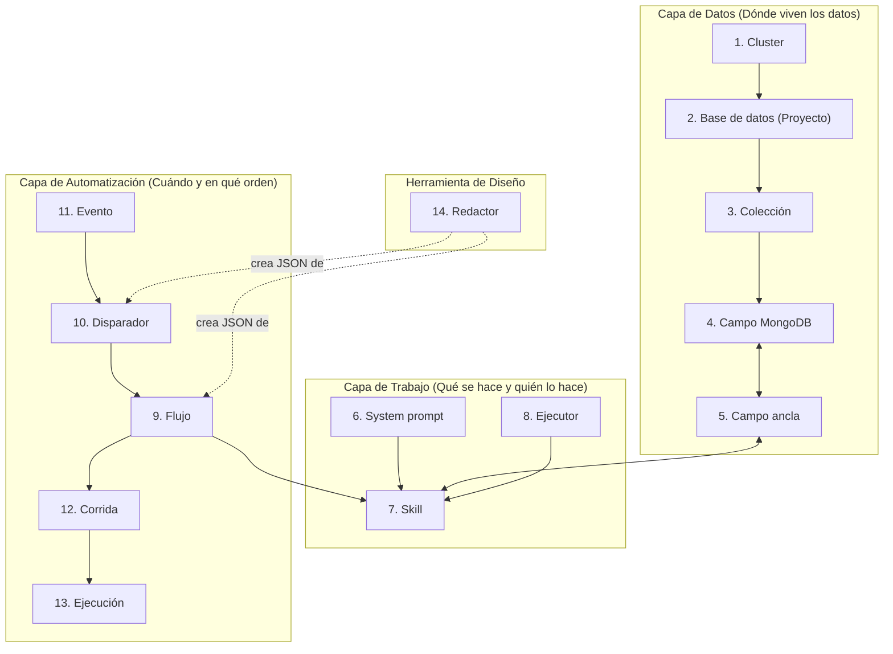

# Fundamentos: catálogo de objetos y conexiones

## Versión

1

Referencia única de todos los objetos de Campos ancla. Cada objeto responde a la misma plantilla fija de 6 puntos: **Qué es**, **Dónde se guarda**, **Qué campos tiene**, **Con quién se conecta**, **Cuándo actúa** y **Ejemplo real**.

---

## Mapa general de conexiones



---

## Bloque A — Capa de datos (dónde se guarda la información)

### 1. Cluster (`clusters`)
1. **Qué es:** Servidor de MongoDB Atlas donde se alojan una o varias bases de datos.
2. **Dónde se guarda:** D1 (`clusters` + `mongo_config_cluster` para la URI cifrada) · `GET /v1/clusters/:id`.
3. **Qué campos tiene:** `id`, `nombre`, `descripcion`, `autoSync`, `lastSync`, `proyectos[]`.
4. **Con quién se conecta:**
   - **Lo usa:** una **Base de datos / Proyecto** (`proyecto.clusterId → cluster.id`).
   - **Apunta a:** la URI cifrada de conexión a MongoDB Atlas (`/v1/clusters/:id/mongo-config`).
5. **Cuándo actúa:** Al diseñar (cuando empujas el esquema a Atlas) y al ejecutar (la API usa su URI para leer y escribir documentos en Mongo).
6. **Ejemplo real:**
   ```json
   {
     "id": "atlas-principal",
     "nombre": "Cluster Atlas",
     "autoSync": false
   }
   ```

---

### 2. Base de datos / Proyecto (`proyectos`)
1. **Qué es:** Un software o proyecto concreto (como Reservas o Llamadas) que agrupa sus colecciones, relaciones y flujos.
2. **Dónde se guarda:** D1 (`proyectos` + versiones) · `GET /v1/proyectos/:id`.
3. **Qué campos tiene:** `id`, `nombre`, `baseDatos` (nombre real de la BD en Mongo), `clusterId`, `colecciones[]`, `relaciones[]`, `skills[]`, `version`.
4. **Con quién se conecta:**
   - **Lo usan:** **Colecciones**, **Flujos** (`flujo.proyectoId`) y **Corridas** (`corrida.proyectoId`).
   - **Apunta a:** un **Cluster** (`proyecto.clusterId → cluster.id`).
5. **Cuándo actúa:** Al diseñar (`POST /v1/proyectos/:id/crear-bd` crea las colecciones y validadores en Atlas) y al ejecutar (indica en qué base de datos de Mongo lee y escribe cada corrida).
6. **Ejemplo real:**
   ```json
   {
     "id": "reservas",
     "nombre": "Software de reservas",
     "baseDatos": "software_reservas",
     "clusterId": "atlas-principal"
   }
   ```

---

### 3. Colección (`colecciones`)
1. **Qué es:** Una tabla de documentos dentro de la base de datos de MongoDB (por ejemplo, `negocios`, `procesos` o `eventos`).
2. **Dónde se guarda:** D1 (dentro de `proyectos.colecciones`) y en MongoDB Atlas · `GET /v1/colecciones`.
3. **Qué campos tiene:** `id` (nombre de la colección), `key` (`proyecto::coleccion`), `proyectoId`, `baseDatos`, `descripcion`, `nCampos`.
4. **Con quién se conecta:**
   - **La usan:** los **Campos MongoDB** (`campoMongo.coleccion`), los **Disparadores** (`disparador.coleccion`) y los **Eventos** (`evento.coleccion`).
   - **Pertenece a:** una **Base de datos / Proyecto** (`coleccion.proyectoId → proyecto.id`).
5. **Cuándo actúa:** Al ejecutar, almacena los documentos reales del negocio y dispara eventos `cambio_datos` cuando se crea, actualiza o borra un documento.
6. **Ejemplo real:**
   ```json
   {
     "key": "reservas::negocios",
     "id": "negocios",
     "proyectoId": "reservas",
     "baseDatos": "software_reservas"
   }
   ```

---

### 4. Campo MongoDB (`mongo`)
1. **Qué es:** Una propiedad física dentro de una colección de MongoDB, con su tipo de dato (`string`, `number`, `array`) y sus reglas de validación.
2. **Dónde se guarda:** D1 (`campos_mongo`) · `GET /v1/mongo/:id`.
3. **Qué campos tiene:** `id`, `campo` (`coleccion.clave`), `proyecto`, `baseDatos`, `coleccion`, `clave`, `bsonType`, `obligatorio`, `ancla`, `indices[]`.
4. **Con quién se conecta:**
   - **Pertenece a:** una **Colección** (`campoMongo.coleccion`).
   - **Se enlaza con:** un **Campo ancla** (`campoMongo.ancla ↔ ancla.ancla`).
5. **Cuándo actúa:** Al diseñar, genera el esquema JSON Schema en MongoDB Atlas; al ejecutar, indica en qué clave exacta de qué colección se guarda el valor de un ancla.
6. **Ejemplo real:**
   ```json
   {
     "id": "negocios-telefono",
     "campo": "negocios.telefono",
     "baseDatos": "software_reservas",
     "coleccion": "negocios",
     "clave": "telefono",
     "bsonType": "string",
     "ancla": "_negocio.telefono_"
   }
   ```

---

### 5. Campo ancla (`anclas`)
1. **Qué es:** Nombre fijo entre guiones bajos (`_ruta.campo_`) que usan las skills y los flujos para pedir y devolver datos sin depender de cómo se llamen las tablas por dentro.
2. **Dónde se guarda:** D1 (`anclas`) · `GET /v1/anclas/:id`.
3. **Qué campos tiene:** `id`, `ancla` (`_..._`), `etiqueta`, `tipo`, `obligatorio`, `baseDatos`, `coleccion`, `claveMongo`, `aliases[]`, `sensible`.
4. **Con quién se conecta:**
   - **Lo usan:** las **Skills** en sus `entradas[]` y `salidas[]`, y las **Corridas** en `corrida.datos`.
   - **Apunta a:** un **Campo MongoDB** (`baseDatos` + `coleccion` + `claveMongo`).
5. **Cuándo actúa:** En ejecución: antes de correr una skill, la API lee de Mongo las anclas de `entradas[]`; al terminar la skill, la API escribe en Mongo las anclas de `salidas[]`.
6. **Ejemplo real:**
   ```json
   {
     "id": "negocio.telefono",
     "ancla": "_negocio.telefono_",
     "etiqueta": "Teléfono del negocio",
     "baseDatos": "software_reservas",
     "coleccion": "negocios",
     "claveMongo": "telefono",
     "tipo": "string"
   }
   ```

---

## Bloque B — Capa de trabajo (qué se hace y quién lo hace)

### 6. System prompt (`system-prompts`)
1. **Qué es:** Instrucción base reutilizable (tono, rol y límites generales) que se antepone a una o varias skills cuando las ejecuta un modelo de IA.
2. **Dónde se guarda:** D1 (`system_prompts` + versiones) · `GET /v1/system-prompts/:id`.
3. **Qué campos tiene:** `id`, `nombre`, `descripcion`, `skills[]`, `versiones[]` (`numero`, `fecha`, `markdown`).
4. **Con quién se conecta:**
   - **Lo usan:** una o muchas **Skills** (`skill.systemPromptId → systemPrompt.id`; cada skill tiene como máximo 1 system prompt).
5. **Cuándo actúa:** En ejecución, cuando el motor o un agente externo pide el contrato de una skill (`GET /v1/ejecutar/:skillId`) para enviárselo al modelo de IA junto con el markdown de la skill.
6. **Ejemplo real:**
   ```json
   {
     "id": "agente-base",
     "nombre": "Agente base",
     "skills": ["descubrir-negocio"]
   }
   ```

---

### 7. Skill (`skills`)
1. **Qué es:** Tarea aislada con una instrucción en markdown que declara exactamente qué anclas necesita de entrada y qué anclas devuelve de salida.
2. **Dónde se guarda:** D1 (`skills` + versiones) · `GET /v1/skills/:id`.
3. **Qué campos tiene:** `id`, `nombre`, `descripcion`, `entradas[]`, `salidas[]`, `systemPrompts[]` (0..1), `ejecutorId`, `versiones[]` (`numero`, `markdown`).
4. **Con quién se conecta:**
   - **La usa:** un nodo de tipo `skill` dentro de un **Flujo** (`nodo.skill → skill.id`).
   - **Apunta a:** **Campos ancla** (`entradas[]`, `salidas[]`), un **System prompt** (`systemPromptId`) y un **Ejecutor** (`ejecutorId`).
5. **Cuándo actúa:** En ejecución, cuando una corrida llega a un nodo que tiene asignada esta skill. Si `salidas` devuelve un ancla que no está declarada en `salidas[]`, la API la rechaza con error 400.
6. **Ejemplo real:**
   ```json
   {
     "id": "descubrir-negocio",
     "entradas": ["_negocio.url_"],
     "salidas": ["_negocio.nombre_", "_negocio.telefono_", "_negocio.url_", "_negocio.zona_horaria_", "_proceso.url_inicio_"],
     "ejecutorId": "modelo-por-defecto"
   }
   ```

---

### 8. Ejecutor (`ejecutores`)
1. **Qué es:** Configuración de quién realiza el trabajo de una skill: un modelo de IA, una función interna de código, un webhook externo, una persona o un bot externo.
2. **Dónde se guarda:** D1 (`ejecutores`) · `GET /v1/ejecutores/:id`.
3. **Qué campos tiene:** `id`, `nombre`, `tipo` (`modelo` | `herramienta` | `integracion` | `humano` | `agente_externo`), `config`, `timeout_s`, `reintentos`, `espera_reintento_s`, `activo`, `version`.
4. **Con quién se conecta:**
   - **Lo usan:** las **Skills** (`skill.ejecutorId → ejecutor.id`; si es `null`, equivale a `agente_externo`).
   - **Genera:** registros en **Ejecuciones** (`ejecucion.ejecutor_id`).
5. **Cuándo actúa:** En ejecución, cuando el motor interno saca un paso de la cola y mira qué `ejecutorId` tiene la skill de ese paso.
6. **Ejemplo real:**
   ```json
   {
     "id": "herramienta-consultar-datos",
     "tipo": "herramienta",
     "config": { "funcion": "consultar-datos" },
     "timeout_s": 60,
     "reintentos": 2,
     "espera_reintento_s": 10
   }
   ```

---

## Bloque C — Capa de automatización (cuándo arranca y cómo avanza)

### 9. Flujo (`flujos`)
1. **Qué es:** Plano versionado de pasos conectados (`nodos` y `aristas`) que define el orden, las decisiones y las esperas de un proceso.
2. **Dónde se guarda:** D1 (`flujos` + versiones) · `GET /v1/flujos/:id`.
3. **Qué campos tiene:** `id`, `nombre`, `proyectoId`, `version`, `nodos[]` (`id`, `tipo`: `inicio|skill|decision|espera|subflujo|fin`, `skill?`, `pipeline?`), `aristas[]` (`desde`, `hacia`, `condicion?`), `mermaid`.
4. **Con quién se conecta:**
   - **Lo arrancan:** los **Disparadores** (`disparador.flujo_id → flujo.id`).
   - **Lo ejecutan:** las **Corridas** (`corrida.flujo_id` + `corrida.flujo_version`).
   - **Apunta a:** **Skills** en sus nodos (`nodo.skill → skill.id`).
5. **Cuándo actúa:** Se edita al diseñar; cuando arranca una corrida, la corrida fija (`pin`) el número de `version` del flujo para que un cambio posterior no rompa las corridas en marcha.
6. **Ejemplo real:**
   ```json
   {
     "id": "reservas-descubrir-mapear",
     "proyectoId": "reservas",
     "version": 1,
     "nodos": [
       { "id": "inicio", "tipo": "inicio" },
       { "id": "descubrir", "tipo": "skill", "skill": "descubrir-negocio" },
       { "id": "mapear", "tipo": "skill", "skill": "mapear-recorrido" },
       { "id": "fin", "tipo": "fin" }
     ],
     "aristas": [
       { "desde": "inicio", "hacia": "descubrir" },
       { "desde": "descubrir", "hacia": "mapear" },
       { "desde": "mapear", "hacia": "fin" }
     ]
   }
   ```

---

### 10. Disparador (`disparadores`)
1. **Qué es:** Regla asociada a un flujo que define cuándo debe crearse una corrida nueva y filtra los datos con un Aggregation Pipeline de MongoDB.
2. **Dónde se guarda:** D1 (`disparadores`) · `GET /v1/flujos/:id/disparadores` y `GET /v1/disparadores/:id`.
3. **Qué campos tiene:** `id`, `flujo_id`, `tipo` (`manual` | `horario` | `cambio_datos` | `webhook`), `activo`, `cron`, `coleccion`, `operaciones[]`, `token`, `pipeline[]`, `anti_bucle`, `agrupar_segundos`, `version`.
4. **Con quién se conecta:**
   - **Pertenece a:** un **Flujo** (`disparador.flujo_id → flujo.id`).
   - **Evalúa:** **Eventos** (`cambio_datos` / `webhook`) o una **Colección** directa (`horario`).
   - **Crea:** **Corridas** (`corrida.disparador_id → disparador.id`).
5. **Cuándo actúa:** En ejecución: cuando ocurre un cambio en Mongo, entra un webhook o salta el cron cada minuto, ejecuta su `pipeline[]`; por cada documento que devuelve el pipeline, abre una corrida nueva.
6. **Ejemplo real:**
   ```json
   {
     "id": "d-f2-cambio",
     "flujo_id": "reservas-descubrir-mapear",
     "tipo": "cambio_datos",
     "activo": true,
     "coleccion": "negocios",
     "operaciones": ["crear", "actualizar"],
     "pipeline": [{ "$match": { "despues.url": { "$exists": true } } }],
     "anti_bucle": true
   }
   ```

---

### 11. Evento (`eventos`)
1. **Qué es:** Registro de algo que acaba de ocurrir (un cambio en una colección de Mongo o la llegada de un webhook) con la foto del antes y del después.
2. **Dónde se guarda:** MongoDB (`eventos`, con borrado automático TTL a los 30 días) · `GET /v1/eventos`.
3. **Qué campos tiene:** `id`, `tipo` (`cambio_datos` | `webhook`), `proyecto_id`, `coleccion`, `documento_id`, `operacion` (`crear|actualizar|borrar`), `antes`, `despues`, `body`, `origen`, `resultado[]`, `creado`.
4. **Con quién se conecta:**
   - **Lo evalúan:** los **Disparadores** activos de esa colección o webhook.
   - **Deja rastro en:** las **Corridas** que haya disparado (`corrida.evento_id → evento.id`).
5. **Cuándo actúa:** En el instante en que se escribe un dato en Mongo o entra un `POST /v1/disparar/:flujo/:token`. Si `origen` empieza por `corrida:` y el disparador tiene `anti_bucle: true`, se ignora para no crear un bucle infinito.
6. **Ejemplo real:**
   ```json
   {
     "id": "ev-cbd3706d2b38",
     "tipo": "cambio_datos",
     "coleccion": "procesos",
     "documento_id": "pelo-sur-proceso",
     "operacion": "actualizar",
     "origen": "corrida:c-75cda45183e74fed",
     "resultado": []
   }
   ```

---

### 12. Corrida (`corridas`)
1. **Qué es:** Una ejecución concreta de un flujo para un negocio, con el estado actual, los datos acumulados y el historial de cada paso.
2. **Dónde se guarda:** MongoDB (`corridas` en la BD del proyecto) + índice en D1 · `GET /v1/corridas/:id`.
3. **Qué campos tiene:** `id`, `flujo_id`, `flujo_version`, `proyectoId`, `negocio`, `estado` (`pendiente|en_curso|esperando_humano|esperando_integracion|esperando_subflujo|completada|fallida|cancelada|atascada`), `paso_actual`, `lease_hasta`, `pasos[]`, `datos`, `errores[]`.
4. **Con quién se conecta:**
   - **Nace de:** un **Flujo** (`flujo_id` + `flujo_version`) y opcionalmente de un **Disparador** (`disparador_id`) y un **Evento** (`evento_id`).
   - **Genera:** registros en **Ejecuciones** (`ejecucion.corrida_id → corrida.id`).
5. **Cuándo actúa:** Desde que arranca hasta que llega al nodo `fin` (`completada`), falla tras agotar reintentos (`fallida`) o se controla desde el panel con los botones **Reintentar**, **Aprobar/Rechazar**, **Reanudar** o **Cancelar**.
6. **Ejemplo real:**
   ```json
   {
     "id": "c-79dfd87a73874b63",
     "flujo_id": "reservas-descubrir-mapear",
     "flujo_version": 1,
     "proyectoId": "reservas",
     "negocio": "pelo-sur",
     "estado": "completada",
     "paso_actual": "fin"
   }
   ```

---

### 13. Ejecución (`ejecuciones`)
1. **Qué es:** Ficha de auditoría de un intento concreto de correr una skill con un ejecutor (qué entradas recibió, qué salidas devolvió, cuánto tardó y cuánto costó).
2. **Dónde se guarda:** MongoDB (`ejecuciones`) y D1 (`skill_ejecuciones` para skills del hub como el Redactor) · `GET /v1/ejecutores/:id/ejecuciones` y `GET /v1/skills/:id/ejecuciones`.
3. **Qué campos tiene:** `id`, `corrida_id`, `nodo_id`, `skill`, `ejecutor_id`, `ejecutor_version`, `prompt_version`, `intento`, `entradas`, `salidas`, `duracion_ms`, `coste`, `estado`, `error`, `creado`.
4. **Con quién se conecta:**
   - **Apunta a:** la **Corrida** (`corrida_id`), la **Skill** (`skill`) y el **Ejecutor** (`ejecutor_id`).
5. **Cuándo actúa:** Cada vez que un ejecutor intenta un paso (si un paso falla 2 veces y a la tercera funciona, la corrida tiene 1 paso y hay 3 documentos en `ejecuciones`: `intento: 0`, `1` y `2`).
6. **Ejemplo real:**
   ```json
   {
     "id": "ej-2e5ae6eb6e134e6d",
     "skill": "mapear-recorrido",
     "ejecutor_id": "modelo-por-defecto",
     "ejecutor_version": 1,
     "estado": "ok",
     "duracion_ms": 14,
     "coste": null
   }
   ```

---

## Bloque D — Herramienta de diseño

### 14. Redactor (`/v1/redactor`)
1. **Qué es:** Bloque del panel y endpoint de la API que convierte una intención escrita en texto normal en una definición JSON válida (un disparador, un flujo o un pipeline).
2. **Dónde se guarda:** No es una tabla; es la herramienta `POST /v1/redactor` respaldada por la skill `generar-definicion` · `GET /v1/redactor`.
3. **Qué campos tiene:** Entrada: `intencion`, `tipo_definicion` (`disparador|flujo|pipeline`), `definicion_actual?`. Salida: `definicion`, `explicacion`, `validacion` (`ok`, `errores[]`, `avisos[]`), `modo`.
4. **Con quién se conecta:**
   - **Usa:** la **Skill** `generar-definicion` (y su **Ejecutor** `modelo-por-defecto`) y lee el catálogo de **Anclas**, **Colecciones** y **Skills** como contexto.
   - **Produce el JSON para:** guardar un **Disparador** o una versión de **Flujo**.
5. **Cuándo actúa:** **Solo al diseñar** en el panel (con los 3 controles: Validar, Probar en dry-run y Confirmar guardado). Nunca interviene mientras corre una corrida en producción.
6. **Ejemplo real:**
   ```json
   {
     "intencion": "cada hora, reservas sin confirmar de hace más de 2 horas",
     "tipo_definicion": "disparador",
     "definicion": {
       "tipo": "horario",
       "cron": "0 * * * *",
       "coleccion": "reservas",
       "pipeline": [{ "$match": { "estado": "sin_confirmar" } }, { "$limit": 100 }]
     }
   }
   ```

---
