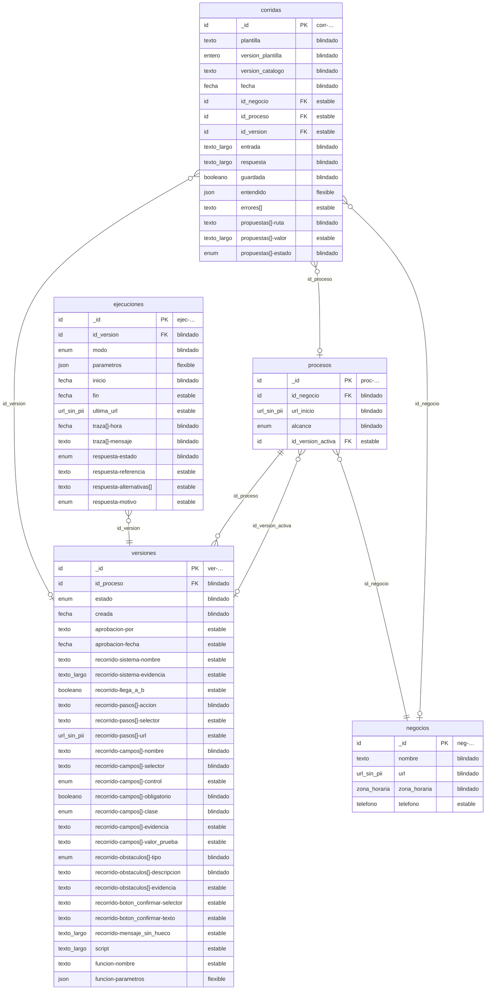

# Esquema de la base de datos

> Generado por `npm run esquema` desde `catalogo/`. No lo edites a mano.

Una caja por colección. Cada línea es un campo: tipo, nombre y nivel. En los nombres, `-` separa niveles del documento y `[]` marca una lista (`recorrido-campos[]-nombre` es `recorrido.campos.N.nombre`). Las líneas entre cajas salen de los campos `id_*`: `||` si el campo es blindado (siempre está) y `o|` si es estable (puede faltar).

