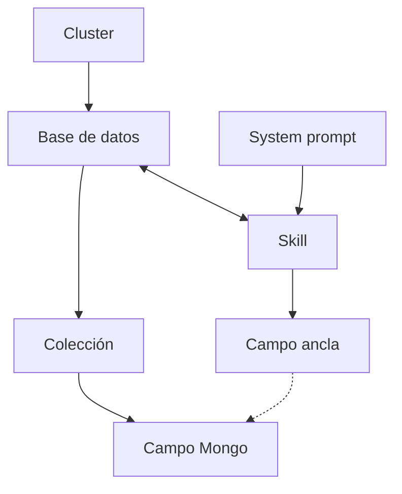

## Relaciones

| Relación | Cómo es | Ejemplo |
|---|---|---|
| Cluster → Base de datos | Un cluster tiene varias bases. | `atlas-principal` tiene `software_reservas`. |
| Base de datos → Colección → Campo Mongo | Es dónde se guarda cada dato. | La colección `negocios` tiene el campo `url`. |
| Base de datos ↔ Skill | Una base usa varias skills, y una skill puede estar en varias bases. | Reservas usa descubrir-negocio. |
| Skill → Campo ancla | La skill lee unas anclas (entradas) y escribe otras (salidas). | descubrir-negocio lee `_negocio.url_`. |
| Campo ancla → Campo Mongo | El ancla es el nombre del dato y el campo Mongo es dónde se guarda. | `_negocio.url_` se guarda en `negocios.url`. |
| System prompt → Skill | Un system prompt sirve a varias skills, pero cada skill tiene solo uno. | `agente-base` lo usa descubrir-negocio. |

Los **agentes** solo entran a trabajar por la API. No forman parte de este esquema.
