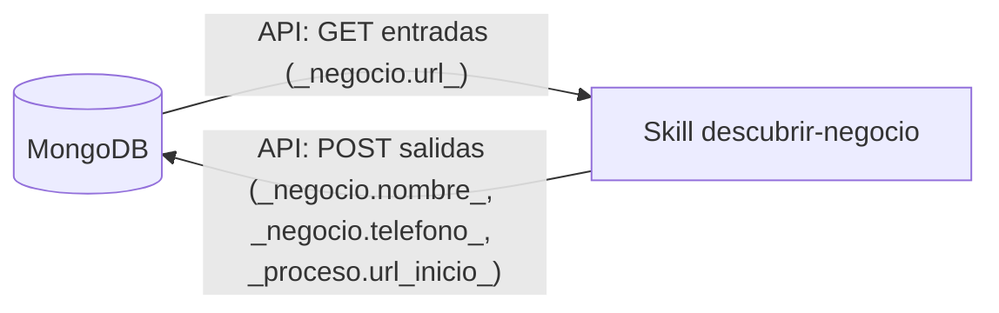

## Entradas y salidas de una skill

Una skill es una tarea concreta, por ejemplo «descubrir negocio». Para hacerla necesita unos datos y, al terminar, produce otros. Tanto los datos que recibe como los que produce son **campos ancla**.

**Entradas (input):** son los campos ancla que la skill **lee** para poder trabajar. Sin ellos no puede empezar.
- Ejemplo: descubrir-negocio necesita `_negocio.url_`, la web del local.

**Salidas (output):** son los campos ancla que la skill **escribe** con su resultado, y quedan guardados en la base de datos.
- Ejemplo: descubrir-negocio devuelve `_negocio.nombre_`, `_negocio.telefono_` y `_proceso.url_inicio_`.

### Cómo viajan los datos

La skill nunca entra directamente en MongoDB. Siempre pasa por la API:

- **MongoDB** es donde se guardan los datos.
- **La API** es el camino: con GET la skill pide sus entradas y con POST guarda sus salidas.
- **Los campos ancla** son los datos que viajan por ese camino.

### Regla clave

La salida de una skill puede ser la entrada de otra. Así se encadenan las skills y se forma la operativa.
- Ejemplo: `_proceso.url_inicio_` sale de descubrir-negocio y es la entrada de mapear-recorrido.
