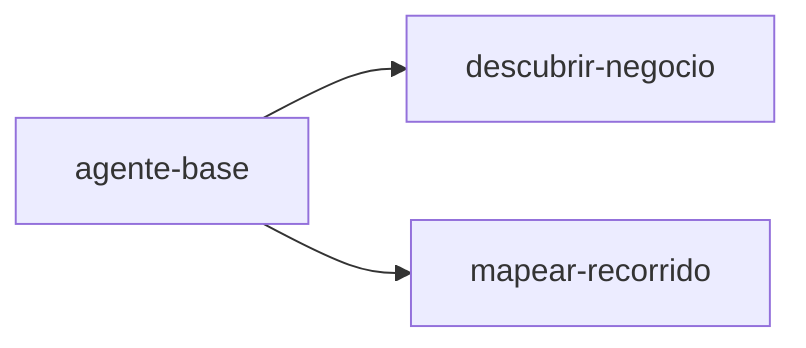

## System prompts

- La **skill** dice **qué hacer**.
- El **system prompt** dice **cómo comportarse** mientras se hace.

Por ejemplo, la skill es la receta («haz una paella») y el system prompt son las normas de la cocina («rápido, limpio y sin improvisar»).

- Un system prompt sirve a varias skills, pero cada skill tiene solo uno.
- Al pedir una skill (`GET /v1/ejecutar/:skill`), la API la entrega junto con su system prompt.
- Si cambias un system prompt, se nota en todas las skills que lo usan.
